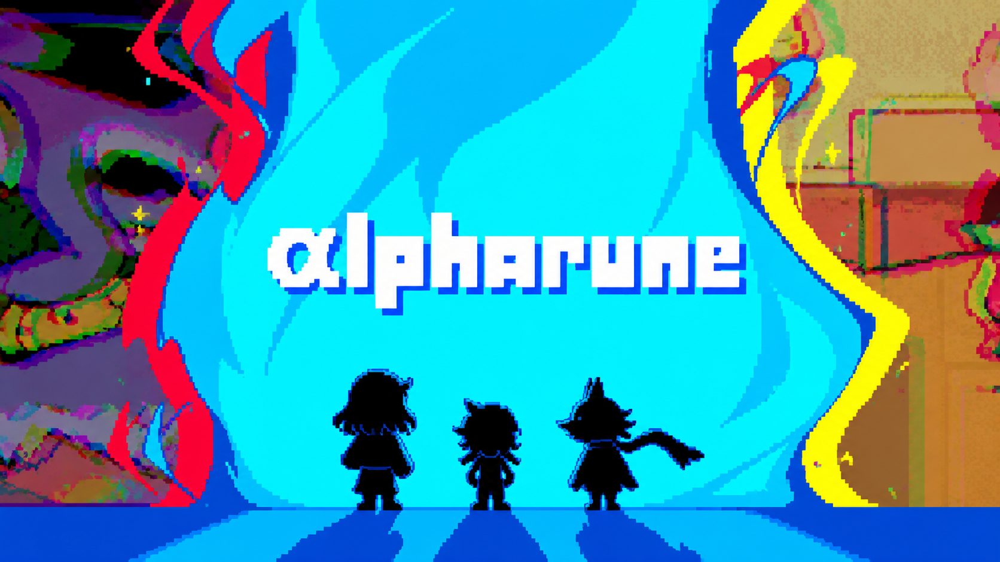
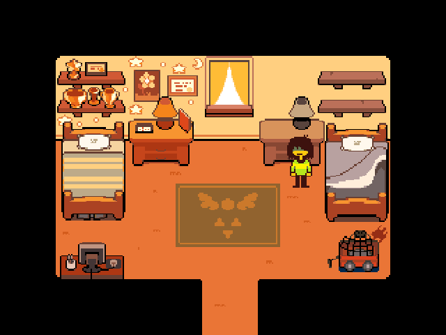
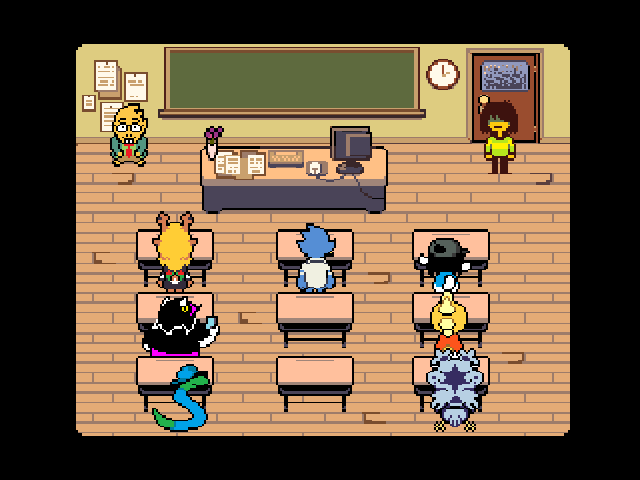
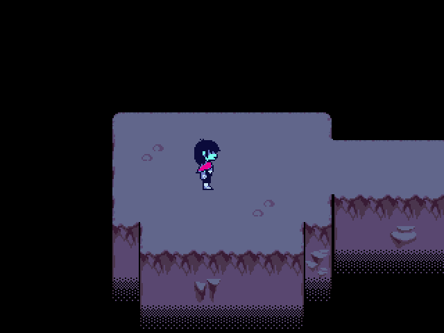
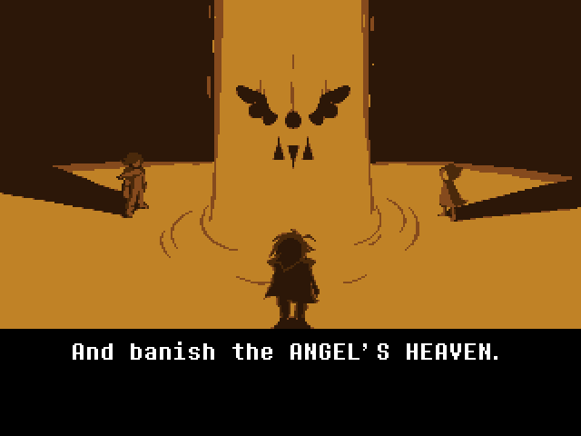
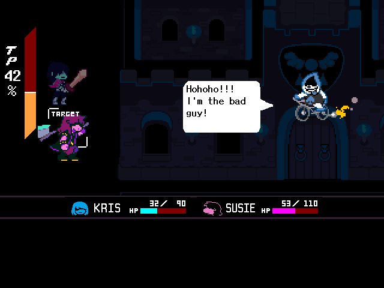
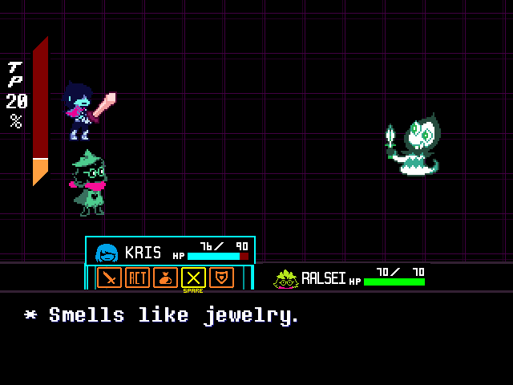

<div align="center">



### A demake of DELTARUNE for the iPhone 4S on iOS 6

_A GML bytecode VM in C, OpenGL ES 2.0, and your own copy of the game_


[](LICENSE)
[](https://github.com/Stiven-Gjekaj/Alpharune/releases/latest)
[](https://ko-fi.com/stivengjekaj)

<p align="center">
  <a href="#overview"><b>Overview</b></a> |
  <a href="#you-need-a-copy-of-deltarune"><b>DELTARUNE</b></a> |
  <a href="#install"><b>Install</b></a> |
  <a href="#build"><b>Build</b></a> |
  <a href="docs/decisions.md"><b>Decisions</b></a> |
  <a href="TODO.md"><b>Roadmap</b></a>
</p>

</div>

---

> [!NOTE]
> **Version 0.7.0 is out.** Chapter 1 plays from the start to the end: the
> school, Castle Town, the Field, the Great Board, the Forest, Card Castle,
> and the King. Version 0.8 makes it faster and smaller on the phone.
> [CHANGELOG.md](CHANGELOG.md) lists the changes of each release.
> [docs/decisions.md](docs/decisions.md) holds each decision and its reason.

> [!IMPORTANT]
> This is a fan project. It is not from Toby Fox. The repository and the
> .deb hold no file of DELTARUNE. You need your own copy.

---

<table>
<tr>
<td width="33%" valign="top">

<p align="center"><i>The room of Kris</i></p>
</td>
<td width="33%" valign="top">

<p align="center"><i>The class</i></p>
</td>
<td width="33%" valign="top">

<p align="center"><i>The Dark World</i></p>
</td>
</tr>
<tr>
<td width="33%" valign="top">

<p align="center"><i>The legend</i></p>
</td>
<td width="33%" valign="top">

<p align="center"><i>Lancer</i></p>
</td>
<td width="33%" valign="top">

<p align="center"><i>A battle in the Field</i></p>
</td>
</tr>
</table>

## Overview

**Alpharune** plays [DELTARUNE](https://deltarune.com/) on an iPhone 4S
with iOS 6.1.3. DELTARUNE itself does not run on iOS 6. Alpharune is a new
runtime in C for the GameMaker data files of the game: a virtual machine
for the GML bytecode, the rooms and the events of GameMaker, and a renderer
for OpenGL ES 2.0.

The app reads the code, the art, the fonts, the text, the sounds, and the
music from the files of your own copy. It holds no file of DELTARUNE. The
game runs its own code, so the scenes, the battles, and the puzzles are
those of DELTARUNE.

The game shows at 853 x 640 in landscape, in the middle of the screen. A
D-pad on the left bar and the Z, X, and C buttons on the right bar control
it. Z confirms, X cancels and runs, and C opens the menu.

## Features

- The chapter select of DELTARUNE, and Chapter 1 from the start to the end
- The scenes, the text, the portraits, the battles, the bullet box, the TP,
  and the save points of the game
- The saves in the format of the PC game, in
  `/var/mobile/Media/Alpharune/save/`
- The sounds and the music, decoded on the phone
- A notice for the chapters that come in a later version

Version 0.7.0 was checked on an iPhone 4S with iOS 6.1.3, and with a
replay of all of Chapter 1 on the Mac.

## You need a copy of DELTARUNE

The code, the art, the sounds, the music, and the text of DELTARUNE belong
to Toby Fox. Alpharune reads them from the files of the PC game.

1. Buy DELTARUNE, for example on Steam.
2. Find the files of the game. On a Mac, they are in
   `DELTARUNE.app/Contents/Resources/`. Alpharune uses the files of
   DELTARUNE 1.0.0 for the Mac.
3. Copy these files and directories to `/var/mobile/Media/Alpharune/` on
   the phone, with an AFC tool or with `scp`:

| File | Size |
| ---- | ---- |
| `game.ios` (the chapter select) | 2.8 MB |
| `options.ini` | 4 KB |
| `chapter1_mac/` | 23 MB |
| `mus/` | 286 MB |

The saves and the settings go in `/var/mobile/Media/Alpharune/save/`.

## Install

You need an iPhone, iPod touch, or iPad with iOS 6 and a jailbreak.

1. Download the `.deb` file from the
   [latest release](https://github.com/Stiven-Gjekaj/Alpharune/releases/latest).
2. Copy it to the phone, for example with `scp` to `/tmp/`.
3. On the phone, as root: `dpkg -i /tmp/io.github.stivengjekaj.alpharune_*.deb`.

The Alpharune icon comes on the home screen. To remove the app:
`dpkg -r io.github.stivengjekaj.alpharune`.

On iOS 7 or later, or with an APT that has TLS 1.2, you can also add the
Cydia source `https://stiven-gjekaj.github.io/cydia/`. Cydia then shows the
updates. Cydia on iOS 6 cannot read it, because its APT stops at TLS 1.0
and GitHub accepts only TLS 1.2. See
[the repository](https://github.com/Stiven-Gjekaj/cydia).

## Build

You need a Mac with Xcode and the iOS 9.3 SDK of Theos.

1. Download `iPhoneOS9.3.sdk.tar.xz` from the releases of
   [theos/sdks](https://github.com/theos/sdks/releases) and unpack it into
   `sdks/`. The result is `sdks/iPhoneOS9.3.sdk`. Git does not track `sdks/`.
2. Run `./fix-sdk.sh` one time. It changes the SDK stubs for the new Apple
   linker and for iOS 6.
3. Build:

| Command | Result |
| ------- | ------ |
| `scripts/app.sh` | `build/Alpharune.app` |
| `scripts/deb.sh` | The Cydia package in `build/` |
| `scripts/mac.sh` | `build/alpharune-mac`, the game on the Mac with no window |
| `scripts/test.sh` | The tests, on the Mac |
| `scripts/test.sh --phone` | The tests, on the phone |
| `scripts/replay.sh` | Replays all of Chapter 1 on the Mac, and checks that it reaches the end |
| `scripts/install.sh` | Builds the app, copies it and the game files to the phone, and opens it |
| `scripts/install.sh --debug` | The same, with a log and the debug commands |
| `scripts/tap.sh` | Sends keys and debug commands to a debug build |
| `scripts/shot.sh` | Saves a screenshot of the phone |
| `scripts/icons.sh` | The icons of the app |
| `scripts/release.sh` | Tests, packs, tags, and publishes a release |

The phone scripts use `ssh iphone4s`. Set up that host in `~/.ssh/config`,
for example with a USB tunnel of `iproxy` on port 2222.

`build.sh` builds one armv7 binary. It compiles with ARC and links without
ARC, and all code is in ARM mode (`-marm`). The new Apple linker makes Thumb
code that crashes on iOS 6 before `main` starts.

`build/alpharune-mac` runs the game on the Mac with no window, from the
files in `/Applications/DELTARUNE.app`. It saves frames as PNG files, plays
a script of keys, and takes commands through a pipe:

```
build/alpharune-mac /Applications/DELTARUNE.app/Contents/Resources --frames 24038 --script tests/play/chapter1.keys
```

`tools/gmdump.py` shows the chunks and the bytecode of a data file.

## Support

If you find Alpharune useful, you can support its development here.

[](https://ko-fi.com/stivengjekaj)

## Licence

The code is under the MIT licence. See [LICENSE](LICENSE). Alpharune uses
stb_vorbis by Sean Barrett under the MIT licence or the public domain, as
[src/third_party/README.md](src/third_party/README.md) tells. DELTARUNE and
its code, art, sounds, music, and text belong to Toby Fox.
